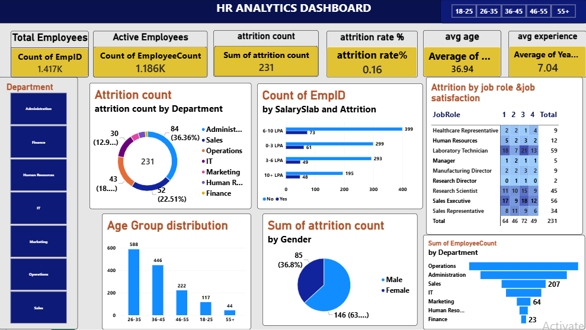

# HR Analytics Dashboard – Power BI
## Project Overview
The HR Analytics Dashboard is a Data Analytics project developed using Microsoft Power BI. The main objective is to analyze employee data and identify workforce trends, employee attrition patterns, and department-wise performance.
The dashboard provides interactive visualizations that help HR teams understand employee demographics, attrition rates, salary distribution, and job satisfaction.
## Dashboard Preview

## Key Performance Indicators (KPIs)
- Total Employees: 1,417
- Active Employees: 1,186
- Attrition Count: 231
- Attrition Rate: 16%
- Average Age: 36.94
- Average Experience: 7.04 Years
## Dashboard Insights
1. Employee attrition is analyzed across different departments.
2. Employee age distribution is visualized across five age groups.
3. Attrition is analyzed by gender.
4. Salary slab analysis compares employee counts and attrition.
5. Job satisfaction is analyzed across different job roles.
6. Department-wise employee distribution is presented.
## Tools and Technologies
- Microsoft Power BI
- Power Query
- DAX
- Microsoft Excel / CSV
- GitHub
## Project Features
- Interactive HR dashboard
- Employee attrition analysis
- Department-wise workforce analysis
- Age group distribution
- Gender-based attrition analysis
- Salary slab analysis
- Job satisfaction analysis
## Business Benefits
This dashboard helps HR departments:
- Identify employee attrition patterns.
- Understand workforce distribution.
- Monitor employee retention.
- Analyze department-wise employee strength.
- Support data-driven HR decisions.
## How to Use
1. Download the repository.
2. Open the `.pbix` file using Microsoft Power BI Desktop.
3. Refresh the dataset if required.
4. Explore the interactive dashboard.
## Author
P Yashwanth Reddy

